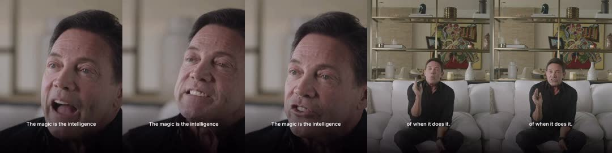

# v03_s07 · aroll_punch · 17.2–20.4s (calidad 2)

- **Guion:** the magic is the intelligence of when it does it.
- **Qué se ve:** Primer plano 3/4 (17.14) → plano medio frontal gesticulando (19.39). (observado 18.0, 19.5)
- **Diseño:** Subtítulo blanco pequeño ~81 %.
- **Efectos:** Grado cinematográfico.
- **Animación:** Cortes secos 17.14 y 19.39.
- **Por qué aquí:** Ritmo de entrevista multicámara (inferido).
