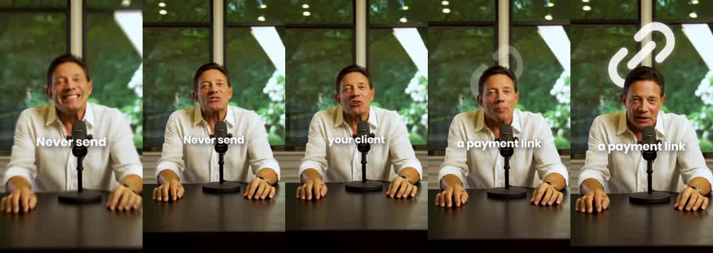

# v05_s01 · aroll_punch · 0.0–3.0s (calidad 4)

- **Guion:** Never send your client a payment link.
- **Qué se ve:** Look B (estudio): él con camisa blanca de lino, sentado a una mesa oscura con micrófono de pie delante, ventanal con jardín verde y luces empotradas detrás. Arranca con zoom-out con desenfoque de movimiento. Subtítulo 'Never send' → 'a payment link'. (observado 0.0–1.5)
- **Diseño:** Subtítulo blanco sans geométrica bold (tipo Poppins Bold), ~3.5 % del alto, sentence case, 1 línea centrada a ~55 % del alto (sobre el pecho, cruzando el micrófono). Banda negra fija en el ~8 % inferior del encuadre (observado en todo el A-roll).
- **Efectos:** Grado cálido con verdes saturados del jardín; blur de movimiento en el zoom inicial (0.0–0.2); sombra suave bajo el subtítulo.
- **Animación:** Zoom-out rápido ~1.25→1.0 con blur, 0.3 s, sensación seca/energética (observado 0.0–0.3). Subtítulo presente desde el frame 0.
- **Por qué aquí:** Hook: orden negativa tajante ('Never…') con impacto de cámara para frenar el scroll (inferido).
