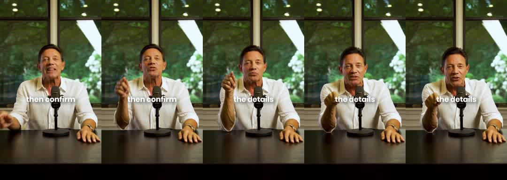

# v05_s14 · aroll_punch · 36.4–37.7s (calidad 3)

- **Guion:** Then confirm the details,
- **Qué se ve:** Cambio de encuadre (36.29) a plano más abierto; 'then confirm'. (observado 36.3–36.4)
- **Diseño:** Sistema base.
- **Efectos:** Ninguno.
- **Animación:** Punch-out por corte a 36.29 (él más pequeño, derivado de la comparación 36.2/36.3).
- **Por qué aquí:** Marca el siguiente paso del proceso (inferido).
