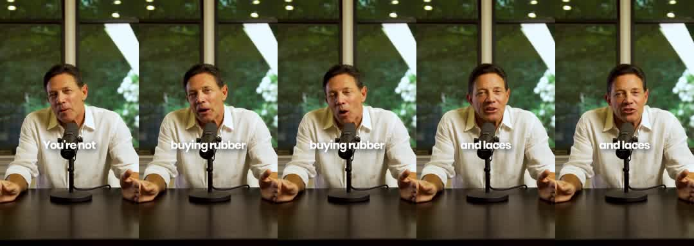

# v07_s03 · aroll_punch · 3.7–5.2s (calidad 3)

- **Guion:** You're not buying a rubber and laces.
- **Qué se ve:** 'You're not buying a rubber and laces.'
- **Diseño:** Fondo de estudio: mesa negra brillante, micrófono de podcast negro en primer plano centrado, ventanal con columnas y vegetación verde desenfocada detrás (no croma). Subtítulos centrados sobre el pecho/micrófono.
- **Efectos:** Grade cálido-verdoso natural, piel cálida, negros profundos en la mesa; bajo el A-roll queda a veces una franja negra inferior (≈5–9 % del alto) cuando el plano está más abierto (observed 3.7, 37.5); sin grano ni viñeta añadida. Franja negra inferior visible en este encuadre.
- **Animación:** Corte de encuadre 3.67 (más abierto/girado).
- **Por qué aquí:** Contraste literal (lo que NO compras) en cara, sin gráfico.
