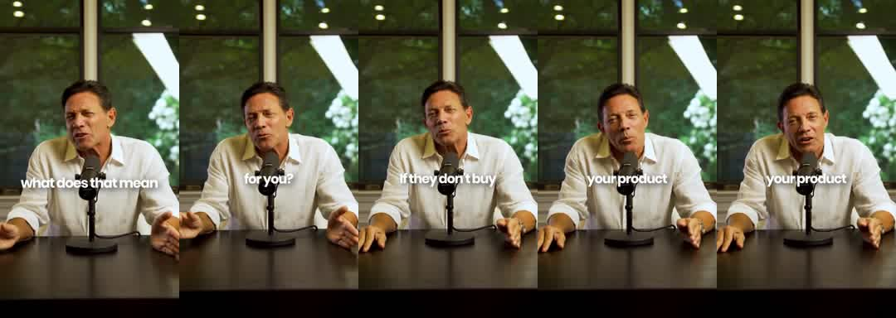

# v07_s11 · aroll_punch · 20.8–23.3s (calidad 3)

- **Guion:** So what does that mean for you? You don't buy your product.
- **Qué se ve:** 'So what does that mean for you? You don't buy your product.'
- **Diseño:** Fondo de estudio: mesa negra brillante, micrófono de podcast negro en primer plano centrado, ventanal con columnas y vegetación verde desenfocada detrás (no croma). Subtítulos centrados sobre el pecho/micrófono.
- **Efectos:** Grade cálido-verdoso natural, piel cálida, negros profundos en la mesa; bajo el A-roll queda a veces una franja negra inferior (≈5–9 % del alto) cuando el plano está más abierto (observed 3.7, 37.5); sin grano ni viñeta añadida.
- **Animación:** Corte de encuadre 20.73 en 'So' (más abierto, girado).
- **Por qué aquí:** Giro al espectador ('para ti'): cambio de plano marca el nuevo bloque.
