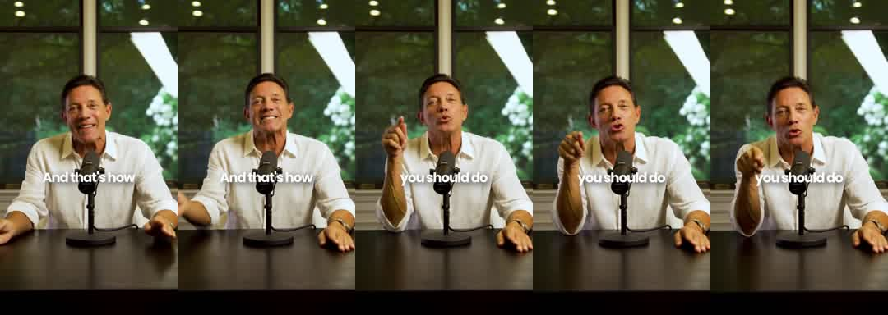

# v07_s23 · aroll_punch · 47.1–48.7s (calidad 3)

- **Guion:** and that's how you should too.
- **Qué se ve:** 'and that's how you should too.' — señala a cámara.
- **Diseño:** Fondo de estudio: mesa negra brillante, micrófono de podcast negro en primer plano centrado, ventanal con columnas y vegetación verde desenfocada detrás (no croma). Subtítulos centrados sobre el pecho/micrófono.
- **Efectos:** Grade cálido-verdoso natural, piel cálida, negros profundos en la mesa; bajo el A-roll queda a veces una franja negra inferior (≈5–9 % del alto) cuando el plano está más abierto (observed 3.7, 37.5); sin grano ni viñeta añadida.
- **Animación:** Corte de encuadre 47.13.
- **Por qué aquí:** Aplicación al espectador: punch marca el 'tú'.
