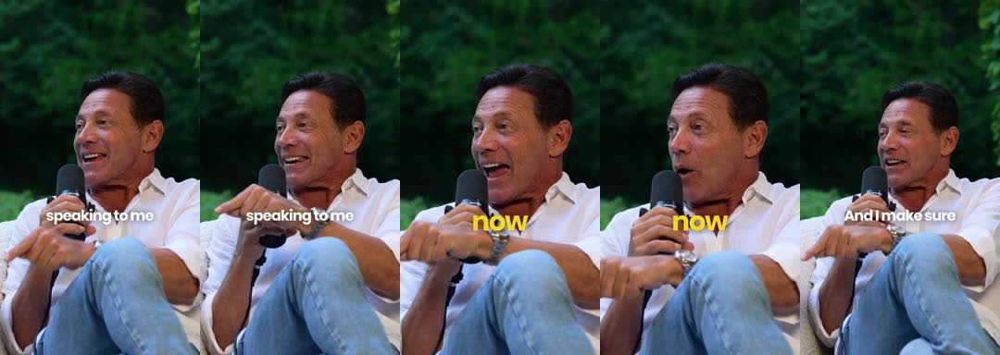

# v13_s22 · aroll_punch · 33.8–34.6s (calidad 4)

- **Guion:** now?
- **Qué se ve:** [observado 34.07–34.5] punch-in a plano más cerrado de Jordan sonriendo; 'now' amarillo solo, grande.
- **Diseño:** 'now' amarillo minúsculas ~5 % alto, centro y≈61 %.
- **Efectos:** Ninguno.
- **Animación:** [observado 34.07] punch-in por corte ~1.0→1.15× + palabra amarilla pop simultáneos.
- **Por qué aquí:** [inferido] Urgencia: la palabra 'now' se golpea con encuadre y color.
