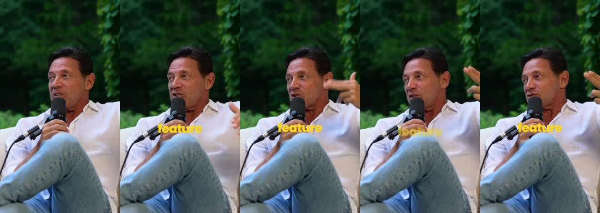

# v19_s09 · aroll_punch · 23.4–24.0s (calidad 3)

- **Guion:** Feature, feature.
- **Qué se ve:** [observed 23.47] Punch-in por corte; 'feature' en amarillo una línea.
- **Diseño:** Amarillo ≈4 % alto, y≈61 %.
- **Efectos:** Ninguno.
- **Animación:** Punch-in seco + amarillo pop.
- **Por qué aquí:** [inferred] Remate burlón: rompe el plano largo.
