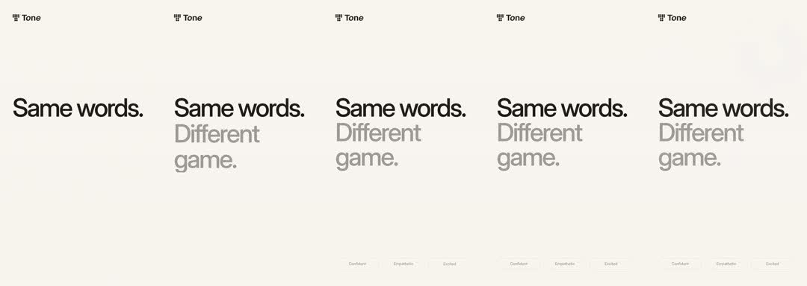

# v02_s01 · full_graphic · 0.0–2.7s (calidad 1)

- **Guion:** (sin voz)
- **Qué se ve:** Anuncio de producto 'Tone' (app de voz). Fondo crema liso, logo '⁞ Tone' pequeño arriba-izquierda; titular 'Same words.' (negro) + 'Different game.' (gris) a la izquierda en el tercio superior; abajo, tres píldoras tenues (Confident / Empathetic / Excited) aparecen hacia 1.0. Sin persona. (observado 0.0–2.6)
- **Diseño:** Sans grotesca neutra (tipo Inter/Neue Haas Medium), alineada a la izquierda con margen ~2 %, 'Same words.' negro #1E1E1E ~5 % del alto, 'Different game.' gris #A3A3A3 mismo tamaño; bloque a y ~33–55 %. Fondo crema #F6F4EF.
- **Efectos:** Ninguno; diseño plano tipo landing page.
- **Animación:** 'Same words.' ya en frame 0; 'Different game.' sube con máscara por línea (0.4–0.6, ~0.2 s, suave). A 2.8 desvanecimiento cruzado con desenfoque hacia la escena azul (~0.3 s).
- **Por qué aquí:** Planteamiento de marca: mismo texto, distinto tono (inferido). FUERA DE ESTILO: no aparece Jordan Belfort.
