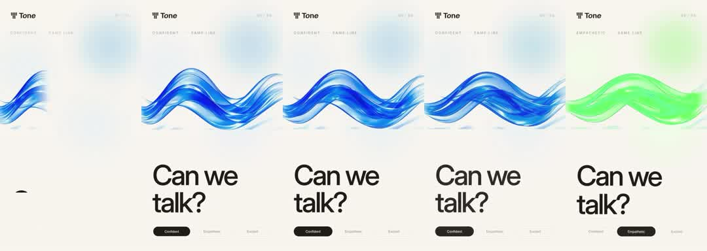

# v02_s02 · full_graphic · 2.7–6.7s (calidad 1)

- **Guion:** Can we talk?
- **Qué se ve:** Cinta 3D de vidrio AZUL ondulada a lo ancho en el tercio superior, orbe azul difuso arriba-derecha, etiquetas 'CONFIDENT · SAME LINE' y '01 / 03'; abajo 'Can we talk?' grande negro y la píldora 'Confident' activa (negra). Voz TTS dice 'Can we talk?' en tono seguro. (observado 3.0–5.7)
- **Diseño:** 'Can we / talk?' sans grotesca medium negra ~8 % del alto, 2 líneas, alineada a la izquierda, y ~62–75 %; píldoras y ~83 %, activa negra #1E1E1E con texto blanco; cinta azul #1F5BE0–#4AA3FF.
- **Efectos:** Render 3D de vidrio/cinta con brillos; orbe con blur gaussiano grande; sin grano.
- **Animación:** Entrada por crossfade + blur (2.6–3.0); texto sube por máscara. La cinta ondula en loop lento. Salida 5.8–6.0: todo se desatura y funde a crema (~0.3 s).
- **Por qué aquí:** Demostración del tono 1/3 (Confident) (inferido). FUERA DE ESTILO.
