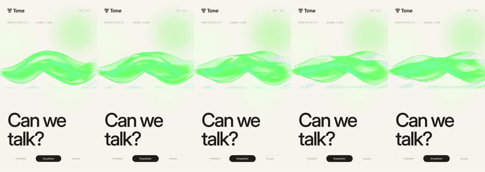

# v02_s03 · full_graphic · 6.7–10.2s (calidad 1)

- **Guion:** Can we talk?
- **Qué se ve:** Misma composición con la cinta y el orbe en VERDE, etiqueta 'EMPATHETIC · SAME LINE', '02 / 03', píldora 'Empathetic' activa. Voz en tono empático. (observado 6.2–10.2)
- **Diseño:** Igual a s02; verde neón #5CF06A/#B2EFB0.
- **Efectos:** Igual; cinta de vidrio verde con brillo.
- **Animación:** Morph de color azul→verde 5.8–6.2 a través de un fundido a crema, el texto sale con fade y vuelve a entrar con máscara de línea (6.1–6.3).
- **Por qué aquí:** Demostración del tono 2/3 (inferido). FUERA DE ESTILO.
