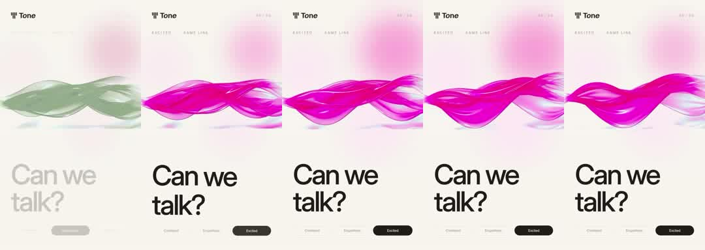

# v02_s04 · full_graphic · 10.2–13.0s (calidad 1)

- **Guion:** Can we talk?
- **Qué se ve:** Cinta y orbe en MAGENTA, 'EXCITED · SAME LINE', '03 / 03', píldora 'Excited' activa. (observado 10.6–14.0)
- **Diseño:** Igual; magenta #E0129A/#F6A8D8.
- **Efectos:** Igual.
- **Animación:** Transición 10.2–10.6: cinta pasa por gris neutro a magenta, texto fade-out y re-entrada por máscara. Salida 14.2–14.4 con fade a crema.
- **Por qué aquí:** Demostración del tono 3/3 (inferido). FUERA DE ESTILO.
