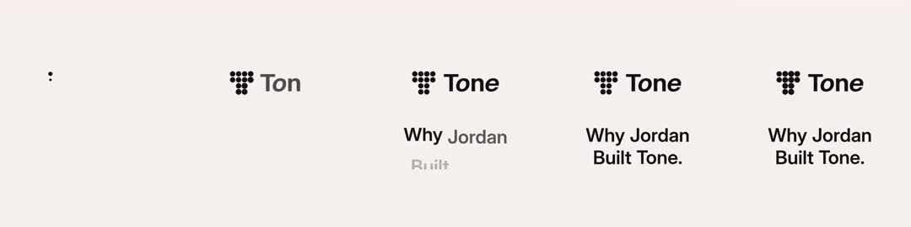

# v03_s01 · full_graphic · 0.0–2.2s (calidad 2)

- **Guion:** (sin voz)
- **Qué se ve:** Tarjeta de título sobre crema: logo '⁞ Tone' negro y debajo 'Why Jordan / Built Tone.' (observado 0.0–2.6).
- **Diseño:** Sans grotesca medium negra (tipo Inter), centrada; logo ~23 % del ancho a y ~36 %; título 2 líneas ~4.5 % del alto a y ~56–66 %. Fondo crema #F4F1EE. Formato 4:5 (720x900).
- **Efectos:** Ninguno.
- **Animación:** Logo se forma desde un punto (0.0–0.6) y 'Tone' se escribe por máscara; título sube por línea con máscara (0.8–1.4). Salida a 2.54: el A-roll sube como cortinilla desde abajo (2.6–2.8, slide vertical ~0.25 s).
- **Por qué aquí:** Título de documental de marca (inferido). FUERA DE ESTILO: anuncio corporativo de Tone, no reel Lobo.
