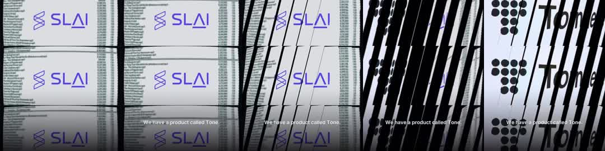

# v03_s04 · full_graphic · 9.8–11.2s (calidad 2)

- **Guion:** We have a product called Tone.
- **Qué se ve:** Muro de pantallas/hojas de cálculo en blanco con el logo 'SLAI' violeta repetido; barrido de franjas negras diagonales (10.4–11.0) revela el muro con logo 'Tone' negro repetido. (observado 8.9–12.5)
- **Diseño:** Rejilla 3 filas de logos; violeta #5B3FD8 'SLAI', negro 'Tone'; subtítulo blanco ~81 %.
- **Efectos:** Glitch/desplazamiento de líneas al entrar (9.0–9.2), monitores con líneas de escaneo.
- **Animación:** Corte 8.93 a pantallas sin logo → logos aparecen con glitch 9.1–9.3; wipe de franjas diagonales negras 10.4–11.1 (~0.7 s) cambia SLAI→Tone.
- **Por qué aquí:** Literal: empresa → producto (inferido).
