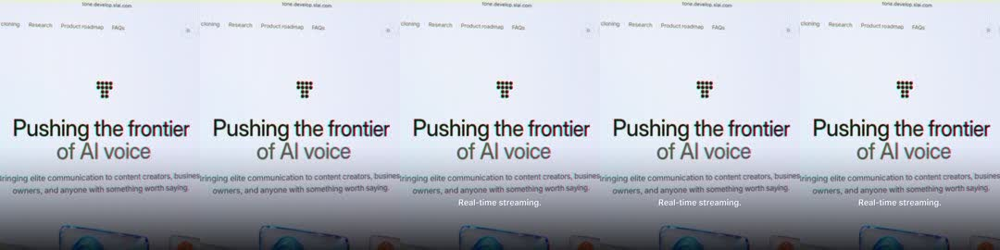

# v03_s06 · full_graphic · 16.1–17.0s (calidad 2)

- **Guion:** Real -time streaming,
- **Qué se ve:** Grabación de la web de Tone: logo de puntos, 'Pushing the frontier / of AI voice', texto pequeño debajo, menú arriba. (observado 15.0–17.0)
- **Diseño:** UI blanca, sans grotesca negra/gris; titular ~5 % del alto centrado a ~50 %.
- **Efectos:** Pantalla grabada con desenfoque de profundidad en los bordes.
- **Animación:** Corte seco 15.06; push-in/deriva lenta de la grabación.
- **Por qué aquí:** Mostrar el producto real mientras habla de la tecnología (inferido).
