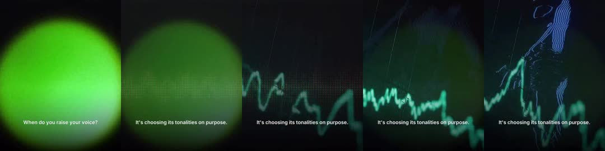

# v03_s09 · full_graphic · 22.4–25.8s (calidad 2)

- **Guion:** your voice? It's choosing its tonalities on purpose.
- **Qué se ve:** Abstracto: orbe verde desenfocado (22.4–23.0) que se disuelve en puntos → onda verde tipo electrocardiograma/bolsa sobre negro (24.0–25.0). (observado)
- **Diseño:** Verde #3CE08A/#69EE72 sobre negro; subtítulo blanco ~81 %.
- **Efectos:** Desenfoque fuerte, partículas/halftone de puntos, glow.
- **Animación:** Corte 22.40; disolución orbe→partículas→onda (23.0–24.0, ~1 s); deriva de cámara sobre la onda.
- **Por qué aquí:** Metáfora visual de 'subir/bajar la voz' (inferido).
