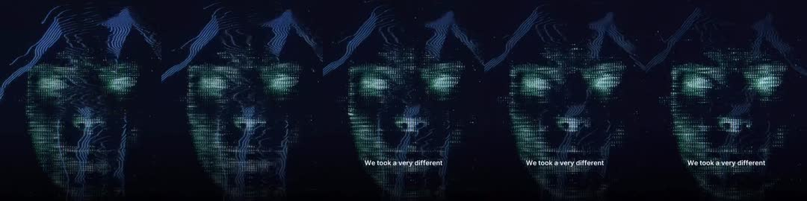

# v03_s10 · full_graphic · 26.2–27.0s (calidad 2)

- **Guion:** We took a very
- **Qué se ve:** Rostro humano holográfico de líneas/puntos azul-verde sobre negro. (observado 25.3–27.0)
- **Diseño:** Líneas cian/azul #3A6FD8 sobre negro.
- **Efectos:** Holograma de scanlines, glow.
- **Animación:** Crossfade desde la onda (25.0–26.3).
- **Por qué aquí:** IA = rostro digital (inferido).
