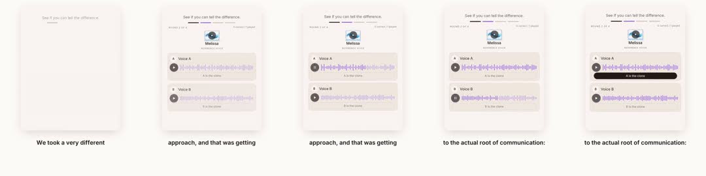

# v03_s11 · full_graphic · 27.2–31.2s (calidad 2)

- **Guion:** different approach and that was getting to the actual route of communication.
- **Qué se ve:** UI de prueba A/B sobre fondo crema: tarjeta 'See if you can tell the difference', avatar 'Melissa', dos reproductores 'Voice A' / 'Voice B' con ondas violetas. (observado 27.3–30.0)
- **Diseño:** Tarjeta blanca redondeada (~70 % del ancho), ondas violeta #8C6CF0; subtítulo NEGRO pequeño sobre fondo claro (~81 %).
- **Efectos:** Sombra suave de tarjeta.
- **Animación:** Corte 27.24 a tarjeta vacía; contenido aparece escalonado (27.3–28.5).
- **Por qué aquí:** Demostrar la diferencia de tono con UI del producto (inferido).
