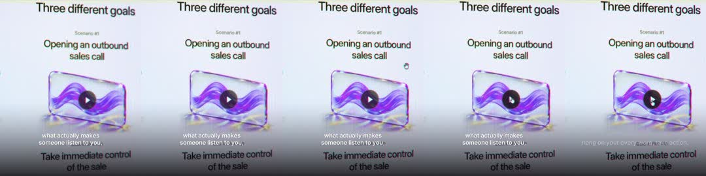

# v03_s13 · full_graphic · 33.4–34.9s (calidad 2)

- **Guion:** listen to you,
- **Qué se ve:** UI 'Three different goals' / 'Scenario #1 Opening an outbound sales call' con tarjeta de vidrio con onda violeta y botón play; abajo 'Take immediate control of the sale'. (observado 33.3–34.7)
- **Diseño:** UI blanca, sans negra; tarjeta de vidrio 3D violeta; titular cortado por arriba.
- **Efectos:** Vidrio 3D, brillos.
- **Animación:** Corte 33.20; cursor pulsa play (34.0–34.7).
- **Por qué aquí:** Caso de uso de ventas (inferido).
