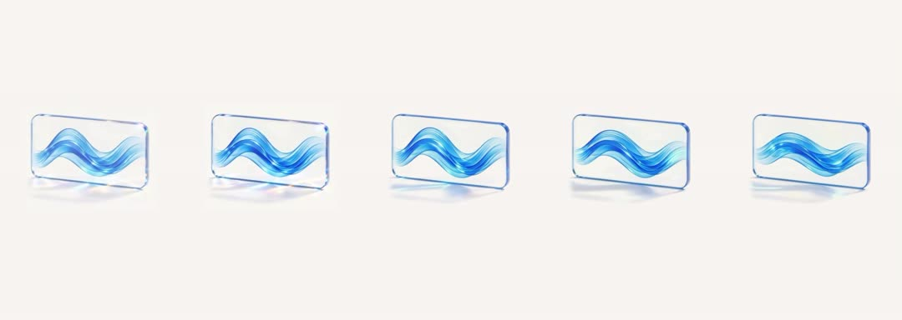

# v04_s01 · full_graphic · 0.0–4.1s (calidad 1)

- **Guion:** Hey, I'm not human, but I can sound like one.
- **Qué se ve:** Anuncio de Tone sin persona: tarjeta de vidrio 3D con onda azul flotando sobre fondo crema, centrada en el tercio superior. Voz sintética. (observado 0.0–3.75)
- **Diseño:** Tarjeta de vidrio rectangular redondeada ~65 % del ancho, centro (50 %, 47 % en tile 0.0); onda azul #1F6BE0/cian; fondo crema #F5F3EF.
- **Efectos:** Render 3D de vidrio con reflejo y sombra suave.
- **Animación:** Flota y rota levemente; desaparece 3.75–4.0 con fade a crema.
- **Por qué aquí:** Hook de producto: 'no soy humano pero sueno como uno' (inferido). FUERA DE ESTILO.
