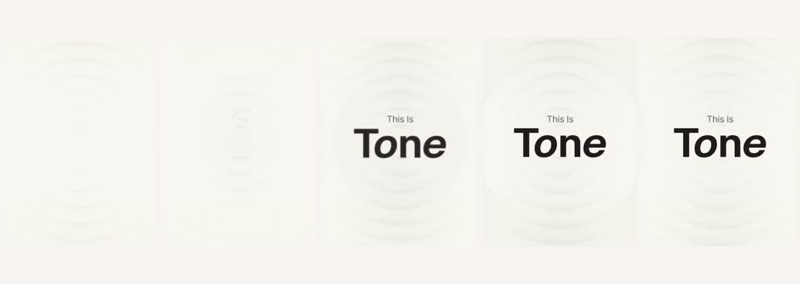

# v04_s02 · full_graphic · 4.1–6.0s (calidad 1)

- **Guion:** (sin voz)
- **Qué se ve:** Ondas concéntricas tenues y 'This Is / Tone' centrado. (observado 4.5–5.75)
- **Diseño:** 'This Is' gris pequeño ~1.5 % del alto; 'Tone' sans grotesca bold negra ~9 % del alto, centro (50 %, 50 %).
- **Efectos:** Anillos concéntricos muy tenues (ondas de sonido).
- **Animación:** 'Tone' entra con blur-in + escala de mayor a menor (4.5–5.0, ~0.5 s).
- **Por qué aquí:** Reveal del nombre (inferido). FUERA DE ESTILO. Límites de escena visuales: tramo sin voz.
