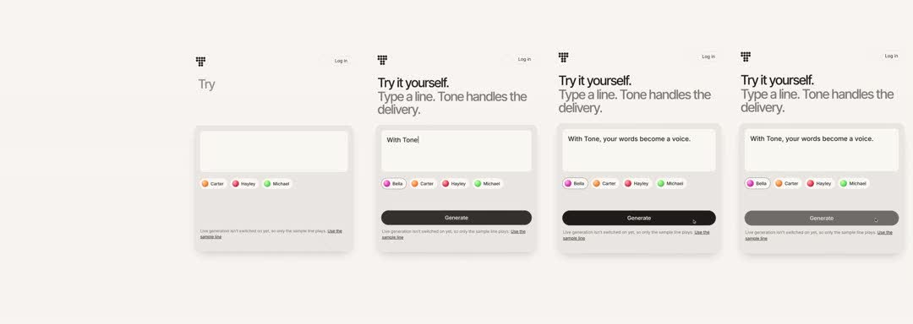

# v04_s03 · full_graphic · 6.0–11.5s (calidad 1)

- **Guion:** (sin voz)
- **Qué se ve:** Grabación de la web 'Try it yourself. Type a line. Tone handles the delivery.': campo de texto donde se escribe 'With Tone, your words become a voice.', chips de voces (Bella, Carter, Hayley, Michael) y botón 'Generate' que el cursor pulsa (~10.5). (observado 6.0–12.0)
- **Diseño:** UI crema/blanca; titular negro + gris ~3 % del alto arriba-izquierda; botón negro a ancho completo.
- **Efectos:** Sombra suave de la tarjeta.
- **Animación:** Titular por máscara de palabra (7.0–8.5); typing letra a letra (8.5–10.0); cursor y clic en Generate (botón negro→gris, 10.5).
- **Por qué aquí:** Demostración de uso (inferido). FUERA DE ESTILO. Tramo sin voz.
