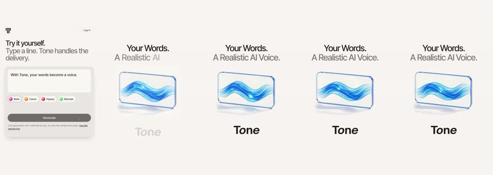

# v04_s04 · full_graphic · 11.5–14.7s (calidad 1)

- **Guion:** With tone, your words become a voice.
- **Qué se ve:** La voz generada lee la frase; corte (12.1) a 'Your Words. / A Realistic AI Voice.' + tarjeta de vidrio + 'Tone'. (observado 12.2–14.5)
- **Diseño:** Titular negro/gris centrado ~3 % del alto a y ~22–28 %; tarjeta centro (50 %, 50 %) ~60 % del ancho; 'Tone' itálica bold a y ~73 %.
- **Efectos:** Vidrio 3D.
- **Animación:** Línea 2 entra por máscara (12.2–12.4).
- **Por qué aquí:** Claim tras la demo (inferido). FUERA DE ESTILO.
