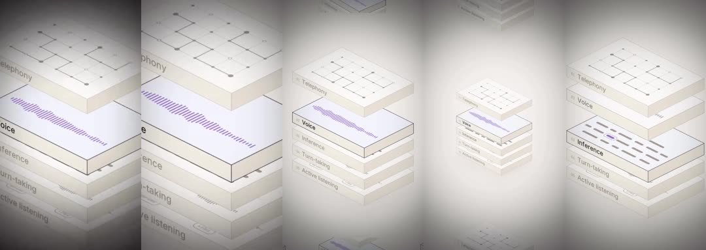

# v04_s05 · full_graphic · 15.2–17.5s (calidad 1)

- **Guion:** Turn your ideas into stories worth hearing.
- **Qué se ve:** Diagrama isométrico de capas apiladas (Telephony / Voice / Inference / Turn-taking / Active listening); la capa activa se separa y muestra una onda violeta o puntos. (observado 15.0–18.0)
- **Diseño:** Placas crema isométricas con etiquetas grises; acento violeta #7B5CE0.
- **Efectos:** Viñeta oscura fuerte en los bordes, profundidad de campo.
- **Animación:** Corte 15.13; cámara se aleja (16.5–16.75) y vuelve a acercarse a la capa Inference (17.0–18.0); capas se desplazan.
- **Por qué aquí:** Explicar la tecnología (inferido). FUERA DE ESTILO.
