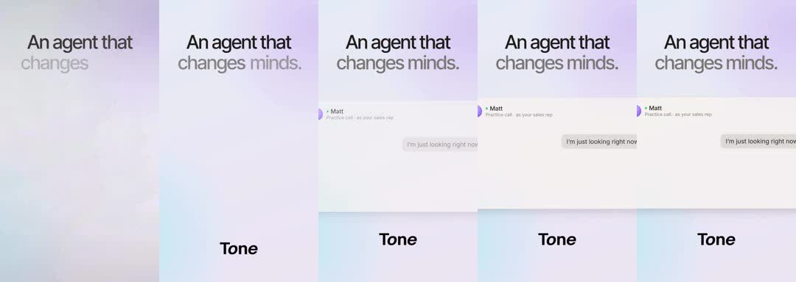

# v04_s06 · full_graphic · 18.3–20.2s (calidad 1)

- **Guion:** An agent that changes minds.
- **Qué se ve:** Fondo degradado lila-celeste con 'An agent that / changes minds.' arriba y 'Tone' abajo. (observado 18.0–19.5)
- **Diseño:** Sans grotesca, negro + gris, ~4 % del alto, centro y ~11–13 %; degradado #D9CCF5→#CFE6F5.
- **Efectos:** Degradado suave.
- **Animación:** Titular entra con fade+blur (18.25); la tarjeta de chat sube desde abajo (~19.5).
- **Por qué aquí:** Segundo caso de uso: agente de ventas (inferido). FUERA DE ESTILO.
