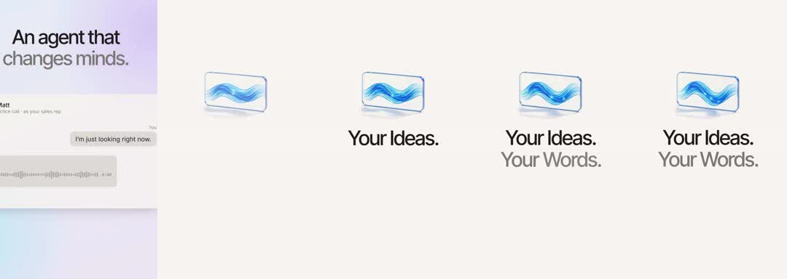

# v04_s08 · full_graphic · 27.1–29.9s (calidad 1)

- **Guion:** Your ideas. Your words.
- **Qué se ve:** Tarjeta de vidrio pequeña + 'Your Ideas.' (negro) / 'Your Words.' (gris) centrado. (observado 27.67–30.3)
- **Diseño:** Tarjeta ~30 % del ancho a y ~33 %; texto ~4 % del alto a y ~49–57 %.
- **Efectos:** Vidrio 3D.
- **Animación:** Corte 27.67 (fondo crema); 'Your Ideas.' entra por máscara a 28.0, 'Your Words.' a 28.67 sincronizado a la voz; salida con fade 30.3–30.7.
- **Por qué aquí:** Claim de cierre (inferido). FUERA DE ESTILO.
