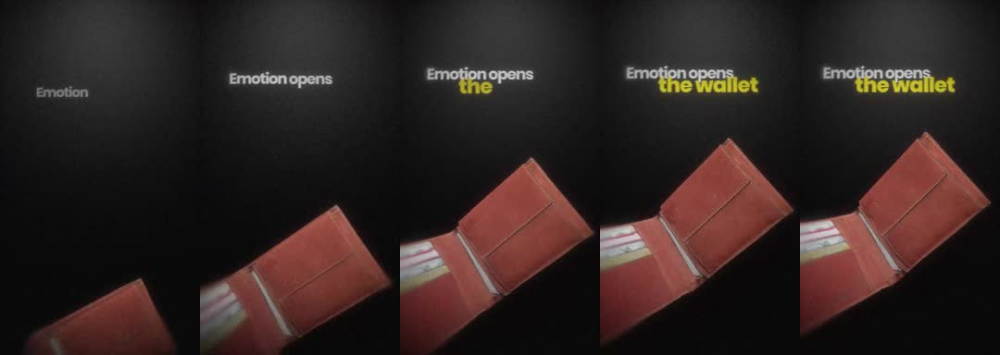

# v07_s20 · full_graphic · 40.8–42.9s (calidad 5)

- **Guion:** Emotion opens the wallet.
- **Qué se ve:** Motion graphic a pantalla completa: fondo gris carbón con degradado radial, una cartera roja 3D entra girando desde abajo-izquierda; arriba 'Emotion opens' (Emotion blanco bold, 'opens' gris regular) y 'the wallet' amarillo debajo.
- **Diseño:** Fondo #1A1A1A→#3A3A3A radial; texto Poppins-like a y≈20–24 %, 'the wallet' amarillo #F8D821 más grande.
- **Efectos:** Desenfoque de movimiento en la cartera, sombra suave, look 3D render.
- **Animación:** Transición: A-roll se oscurece (dip a negro 2 fr, 40.71→40.78); texto blur-in palabra a palabra ('Emotion' 40.98, 'opens' 41.4, 'the' 41.7, 'wallet' 42.0); cartera rota lentamente.
- **Por qué aquí:** Aforismo memorable → se 'sale' del A-roll a un gráfico limpio para que la frase pese.
