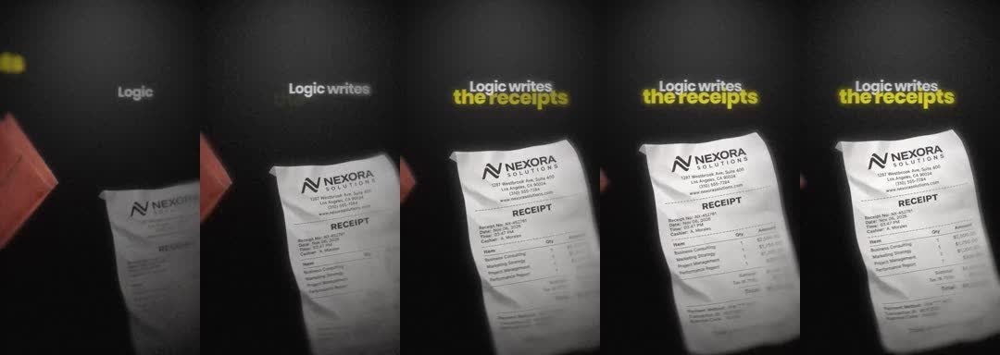

# v07_s21 · full_graphic · 43.2–44.6s (calidad 5)

- **Guion:** Logic writes the receipt.
- **Qué se ve:** Mismo fondo: la cartera y el texto anterior salen hacia la izquierda con blur; sube un recibo blanco 3D curvado ('NEXORA SOLUTIONS — RECEIPT'); 'Logic writes' / 'the receipts' (amarillo).
- **Diseño:** Igual que el anterior; recibo centrado x 15–85 %, y 40–100 %.
- **Efectos:** Motion blur en la salida, recibo con sombras de pliegue.
- **Animación:** Transición interna 43.17: texto y cartera se deslizan a la izquierda con blur (≈0.15 s) mientras el recibo entra desde abajo; 'Logic' 43.24, 'writes' 43.37, 'the receipts' ≈44.0.
- **Por qué aquí:** Segunda mitad del aforismo con su objeto literal (recibo).
