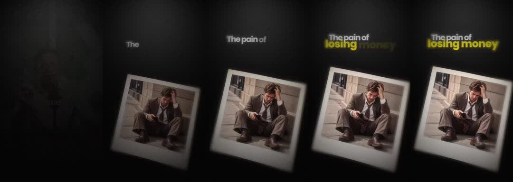

# v12_s13 · full_graphic · 34.8–36.0s (calidad 5)

- **Guion:** the pain of losing money
- **Qué se ve:** [observado 35.2–36.0] Fondo negro con degradado gris radial; una foto polaroid (hombre en traje sentado en el suelo con la mano en la cabeza) entra girada desde abajo-izquierda. Arriba 'The pain of' blanco + 'losing money' amarillo.
- **Diseño:** Polaroid con marco blanco grueso, ~60 % del ancho, centro x≈55 % y≈68 %, girada ~-12°. Texto arriba (y≈30 %), blanco pequeño + amarillo minúsculas ~1.3×.
- **Efectos:** Viñeta/degradado negro, sombra bajo la polaroid, motion blur de entrada; foto con tono cálido apagado.
- **Animación:** [observado 34.87–35.4] polaroid entra deslizando+rotando desde abajo-izq. con motion blur (~0.4 s, ease-out); texto write-on por palabra con blur ('The' → 'The pain' → 'The pain of'); 'losing money' ~35.5.
- **Por qué aquí:** [inferido] 'Picture in the head' → literalmente fotos: dolor (pérdida) mostrado como recuerdo impreso.
