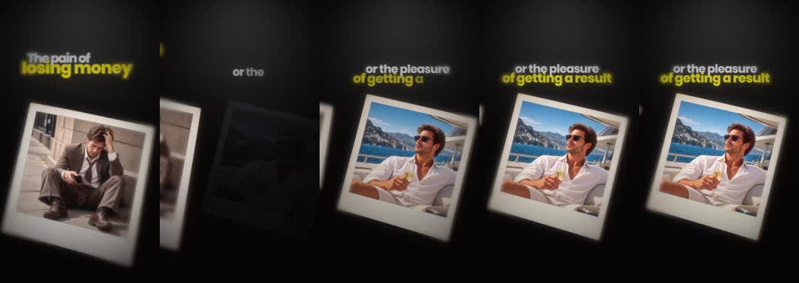

# v12_s14 · full_graphic · 36.0–38.2s (calidad 5)

- **Guion:** or the pleasure of getting a result
- **Qué se ve:** [observado 36.3–37.5] Whip lateral: la primera polaroid sale por la izquierda y entra otra (hombre con gafas de sol y copa en un yate, mar azul). 'or the pleasure' + 'of getting a result' amarillo.
- **Diseño:** Polaroid igual, ~60 % ancho, centro x≈55 % y≈60 %, girada ~+10°. Texto arriba y≈28 %.
- **Efectos:** Motion blur horizontal fuerte en el barrido; foto saturada azul (contraste con la gris anterior).
- **Animación:** [observado 36.16–36.4] slide/whip horizontal ← con motion blur ~6 fr; texto anterior sale con el barrido; 'or the' write-on y 'pleasure' en gris→blanco; 'of getting a result' amarillo ~37.4.
- **Por qué aquí:** [inferido] Dolor vs placer: dos fotos en carrusel; el color (gris→azul) refuerza la emoción.
