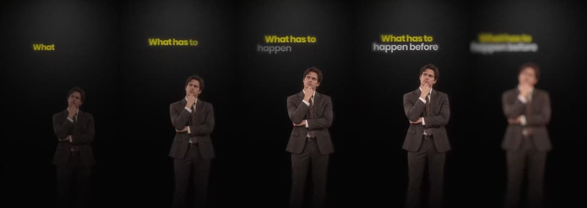

# v14_s13 · full_graphic · 22.0–23.3s (calidad 4)

- **Guion:** What has to happen before it is the
- **Qué se ve:** [observado 22.1–23.2] Fondo negro con degradado; figura de hombre en traje pensando (mano en la barbilla) con halo, de cuerpo entero, centrada. Arriba 'What has to' amarillo + 'happen before' blanco.
- **Diseño:** Figura ~25 % ancho, x≈50 %, y≈45–90 %. Texto y≈22–25 %, ~2.5 % alto.
- **Efectos:** Glow/difusión tipo holograma sobre la figura, negro con viñeta.
- **Animación:** [observado 22.07–22.6] figura entra con fade y desenfoque→nitidez; texto write-on con blur.
- **Por qué aquí:** [inferido] Pregunta reflexiva → personaje 'pensando' sin Jordan.
