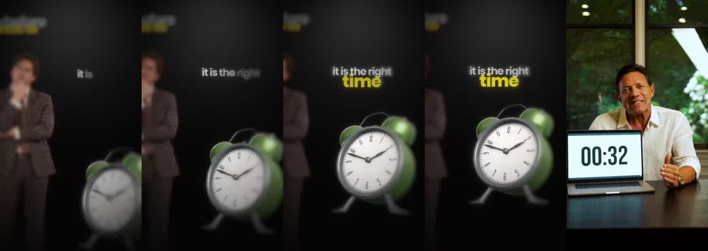

# v14_s14 · full_graphic · 23.3–24.2s (calidad 4)

- **Guion:** right time?
- **Qué se ve:** [observado 23.3–24.0] La figura se desenfoca/agranda y un despertador 3D verde rueda/entra desde abajo-derecha; 'it is the right' blanco + 'time' amarillo.
- **Diseño:** Despertador ~30 % ancho, x≈65–95 %, y≈55–80 %. Texto y≈25 %.
- **Efectos:** Blur de la figura al pasar a segundo plano.
- **Animación:** [observado 23.27–23.5] zoom-in/desenfoque de la figura + reloj entra con slide+escala ~0.3 s; 'time' amarillo pop 23.6.
- **Por qué aquí:** [inferido] Literal: 'right time' = reloj.
