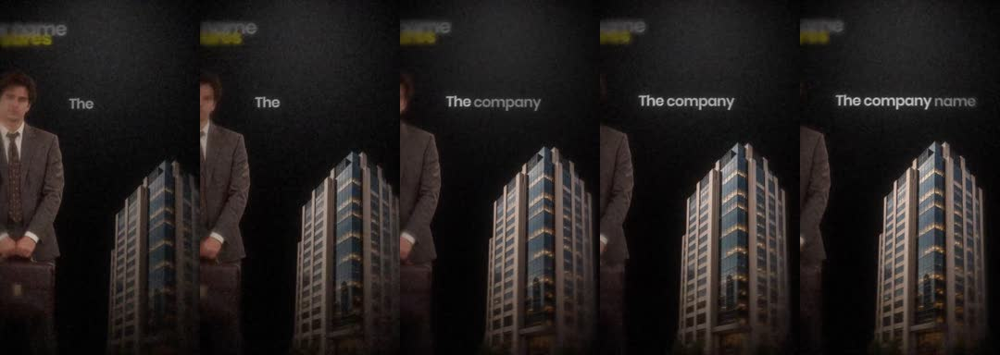

# v18_s06 · full_graphic · 13.3–14.2s (calidad 4)

- **Guion:** the company name.
- **Qué se ve:** [observed 13.1–14.4] Slide de cámara a la derecha: el vendedor sale por la izquierda y entra un rascacielos de cristal iluminado; texto 'The company name'.
- **Diseño:** Rascacielos ≈45 % ancho abajo-derecha; texto blanco con 'company name' gris→blanco ≈3 % alto, y≈18 %.
- **Efectos:** Motion blur en el slide, viñeta.
- **Animación:** [observed] Slide horizontal con blur ≈0.3 s (12.85–13.35); texto write-on por palabra.
- **Por qué aquí:** [inferred] Literal: 'company' = edificio corporativo.
