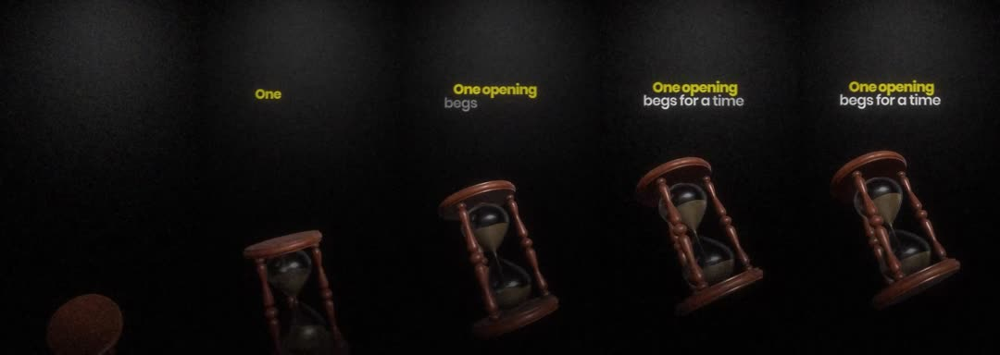

# v18_s16 · full_graphic · 39.9–42.0s (calidad 5)

- **Guion:** One opening begs for time.
- **Qué se ve:** [observed 39.8–42.3] Negro con grano; reloj de arena 3D de madera entra desde abajo girando; texto arriba 'One opening' amarillo / 'begs for a time' blanco.
- **Diseño:** Reloj ≈35 % ancho, centro-abajo; texto ≈3 % alto, y≈20–25 %.
- **Efectos:** Grano/ruido en el negro, viñeta, desenfoque de profundidad.
- **Animación:** [observed] Corte a negro 39.8; reloj sube rotando 40.0–41.6; texto write-on por palabra gris→color (40.2 'One', 40.6 'opening', 41.0 'begs'…).
- **Por qué aquí:** [inferred] Metáfora: tiempo = reloj de arena.
