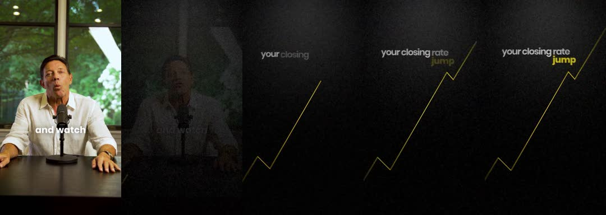

# v20_s21 · full_graphic · 54.7–56.5s (calidad 5)

- **Guion:** watch your closing rate jump.
- **Qué se ve:** [observed 55.14–56.77] Fondo negro texturizado; línea amarilla fina en zigzag que sube en diagonal (gráfico de crecimiento) dibujándose; texto 'your closing rate' blanco/gris + 'jump' amarillo arriba-izquierda.
- **Diseño:** Texto ≈3 % alto, y≈22–26 %, x≈25–70 %; línea ≈1 px@320 amarilla de abajo-izq a arriba-dcha.
- **Efectos:** Grano/textura en el negro, viñeta.
- **Animación:** [observed] Línea se dibuja 55.17→56.0; texto write-on por palabra gris→blanco ('your' 55.34, 'closing' 55.67, 'rate' 56.0, 'jump' amarillo 56.0).
- **Por qué aquí:** [inferred] Dato/resultado → gráfico.
