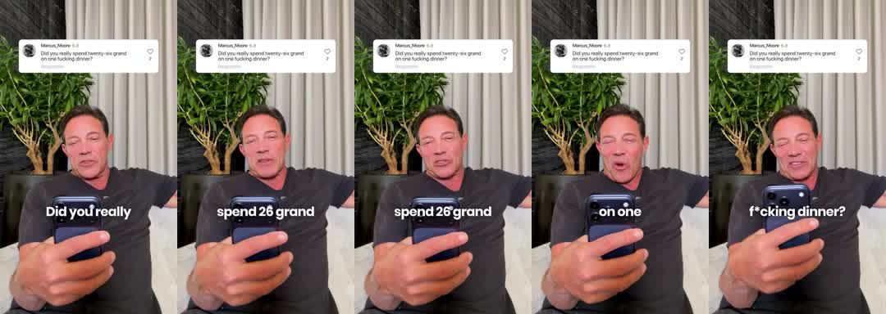

# v01_s01 · hook_comment · 0.0–3.9s (calidad 5)

- **Guion:** Did you really spend 26 grand on one fucking dinner?
- **Qué se ve:** Look A (casual, celular). Él sentado en sofá blanco con camiseta negra, planta de bambú y cortina beige detrás, sosteniendo un iPhone azul delante del pecho como si leyera. Arriba, tarjeta de comentario estilo Instagram: avatar redondo, 'Marcus_Moore 6 d', 'Did you really spend twenty-six grand on one fucking dinner?', corazón con '2', 'Responder'. Subtítulos: 'Did you really' → 'spend 26 grand' → 'on one' → 'f*cking dinner?'. (observado 0.0, 1.0, 3.0)
- **Diseño:** Tarjeta blanca #FFFFFF con texto negro sans regular (tipo SF/Inter), nombre en semibold, 'Responder' gris #9A9A9A; x 11–89 % del ancho (~79 %), y 12.7–23 % del alto, radio ~10 px (~1.4 % del ancho), sin sombra visible. Subtítulo blanco sans geométrica bold (tipo Poppins Bold/SemiBold), minúsculas de frase, ~3.5 % del alto, centrado en x, línea base a ~67 % del alto (sobre el pecho/teléfono).
- **Efectos:** Sin grado añadido visible (luz natural cálida de interior); sombra suave bajo el subtítulo; sin textura. 'fucking' censurado como 'f*cking' en el subtítulo (observado 3.0).
- **Animación:** La tarjeta ya está en el frame 0 y sale con el corte seco de 4.10 (observado 0.0–4.0). Subtítulos cambian de bloque por corte seco, sin pop ni escala (observado 0.0–0.47 a 30 fps).
- **Por qué aquí:** Hook: pregunta polémica de un seguidor (dato escandaloso '26 grand') como promesa; él 'leyendo' el móvil legitima que responde a la audiencia (inferido).
