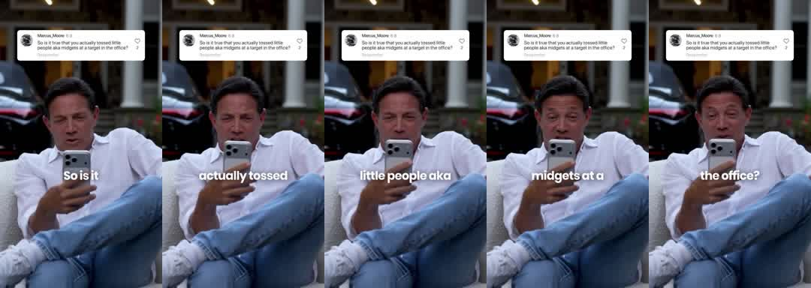

# v06_s01 · hook_comment · 0.0–7.7s (calidad 4)

- **Guion:** So is it true that you actually tossed little people, AKA midgets, at a target in the office?
- **Qué se ve:** Él sentado en sofá blanco exterior mirando el móvil, como leyendo; arriba una tarjeta blanca de comentario de Instagram: avatar, 'Marcus_Moore 6 d', 'So is it true that you actually tossed little people aka midgets at a target in the office?', corazón y '2', 'Responder'.
- **Diseño:** Subtítulo blanco Poppins-like bold centrado a ~61 % del alto; sin palabra destacada ni amarillo. Tarjeta blanca #FFFFFF, texto negro pequeño (sans de Instagram), esquinas redondeadas pequeñas.
- **Efectos:** Sin texturas añadidas; grade natural cálido de atardecer (fondo #090705/#302F2E, piel cálida, camisa blanca ligeramente azulada #AAB2D1); fondo desenfocado por profundidad de campo (casa con columnas blancas, coche negro).
- **Animación:** La tarjeta está desde el frame 0 (sin entrada visible) y desaparece con el jump cut de 8.03 s; captions cambian cada 2–3 palabras.
- **Por qué aquí:** Hook: pregunta polémica de un seguidor = prueba social + curiosidad ('¿es verdad?'); él la 'lee' en el móvil para que la escena parezca respuesta real.
