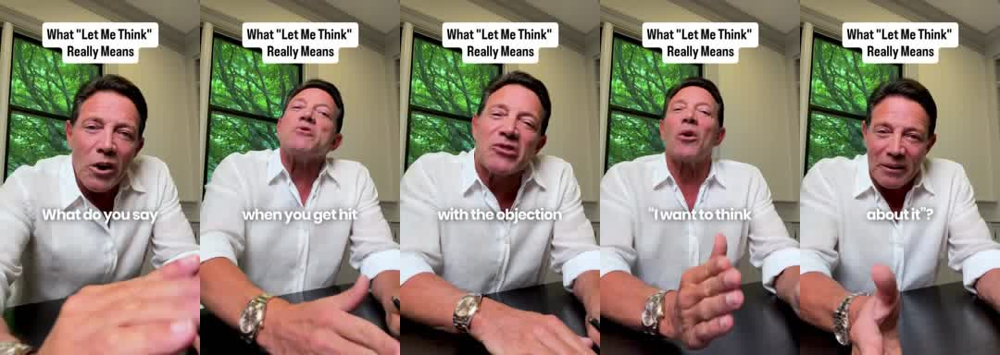

# v16_s01 · hook_comment · 0.0–3.4s (calidad 4)

- **Guion:** What do you say when you get hit with the objection? I want to think about it.
- **Qué se ve:** [observed 0.0–3.5] Look A: Jordan sentado a una mesa negra, camisa blanca de lino, ventana con árboles verdes a la izquierda, cámara de celular baja. Arriba, tarjeta de título 'What "Let Me Think" / Really Means'. Subtítulo central por frases ('What do you say', 'when you get hit', 'with the objection', '"I want to think', 'about it"?').
- **Diseño:** Tarjeta: dos cajas blancas redondeadas apiladas (estilo texto nativo TikTok/IG), texto negro sans condensada bold (tipo Oswald/Bebas-like, mayúsc./minúsc.), bloque ≈58 % del ancho centrado, y ≈6.5–17 % del alto. Subtítulo: sans geométrica bold (tipo Poppins Bold) blanca en minúsculas/sentence case, ≈3.5 % del alto de cap, centrada a ≈60 % del alto (sobre el pecho), 2–4 palabras.
- **Efectos:** Sin grado añadido apreciable: blancos limpios, verde saturado de ventana, piel cálida. Sombra suave oscura bajo el subtítulo (sin contorno grueso visible).
- **Animación:** [observed] Tarjeta presente desde el frame 0 y desaparece de corte en 3.6 s (con 'I'm'). Subtítulo cambia de bloque en 1 frame, sin pop ni escala visible. Sensación seca.
- **Por qué aquí:** [inferred] Hook: la tarjeta promete descodificar una objeción concreta que todo vendedor ha oído; la pregunta en voz y la tarjeta a la vez = dos ganchos en paralelo.
