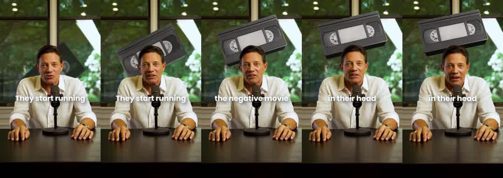

# v05_s04 · icon_overlay · 6.9–9.2s (calidad 5)

- **Guion:** They start running the negative movie in their head.
- **Qué se ve:** Una cinta VHS negra 3D entra por la izquierda girando y se coloca inclinada sobre su cabeza mientras dice 'negative movie'. Subtítulos 'They start running' / 'the negative movie' / 'in their head'. (observado 7.0–9.2)
- **Diseño:** Cinta VHS fotográfica recortada, ~55–65 % del ancho, centro ~(50 %, 15 %), inclinada −15°, por delante del fondo y detrás/sobre la cabeza (le tapa parte del pelo).
- **Efectos:** Sombra leve; sin glow.
- **Animación:** Slide desde la izquierda con rotación (7.0–7.6, ~0.6 s, ease-out), luego leve balanceo; sale con el corte a 9.34. Dura ~2.3 s.
- **Por qué aquí:** Metáfora literal: 'película mental' = cinta de video (inferido).
