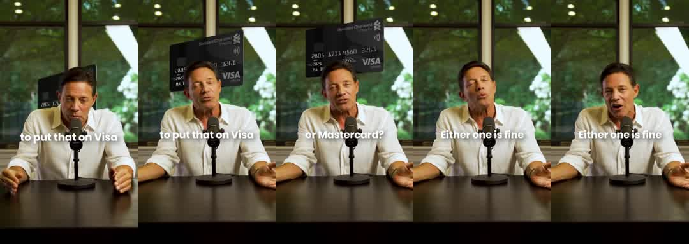

# v05_s12 · icon_overlay · 27.8–30.7s (calidad 4)

- **Guion:** Do you wanna put that on? These are a mastercard. Either one is fine.
- **Qué se ve:** Punch (27.78) y una tarjeta de crédito negra (Standard Chartered, VISA) aparece sobre su cabeza al decir 'Visa'. Subtítulos 'Do you want' / 'to put that on Visa' / 'or Mastercard?' / 'Either one is fine'. (observado 28.0–29.8)
- **Diseño:** Tarjeta fotográfica recortada ~45 % del ancho, centro ~(50 %, 18 %), inclinada ~−10°, detrás/sobre la cabeza.
- **Efectos:** Ligera sombra; reflejo del plástico.
- **Animación:** Entra ~27.9–28.0 con escala/slide corto desde abajo-izquierda y leve rotación; flota; sale con fade 29.7–29.9. Dura ~1.9 s.
- **Por qué aquí:** Literal: 'Visa or Mastercard' → tarjeta (inferido).
