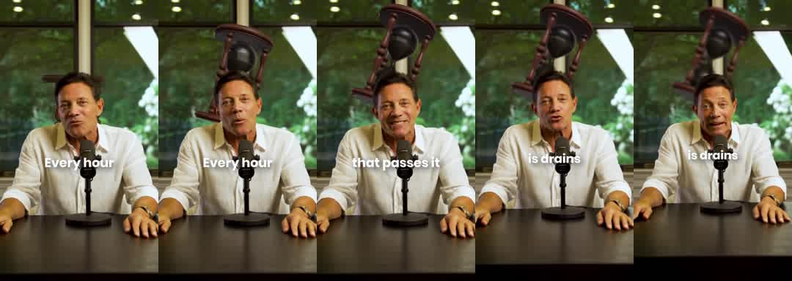

# v05_s17 · icon_overlay · 42.6–45.1s (calidad 5)

- **Guion:** Every hour that passes, it dreams.
- **Qué se ve:** Un reloj de arena de madera 3D cae sobre su cabeza y queda inclinado detrás. 'Every hour' / 'that passes it' / 'is drains'. (observado 42.6–44.8)
- **Diseño:** Reloj de arena fotográfico recortado, ~40 % del ancho, centro ~(50 %, 15 %), inclinado ~20°, parcialmente cortado por el borde superior.
- **Efectos:** Ninguno visible.
- **Animación:** Entra desde arriba con caída + rotación (42.6–43.0, ~0.4 s), balanceo; sigue tras el punch-in de 44.4 y sale ~44.9 (desconocido exacto).
- **Por qué aquí:** Literal/metáfora: 'every hour' / vida media → tiempo que se agota (inferido).
