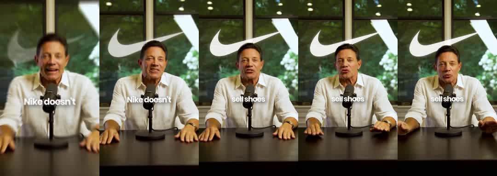

# v07_s01 · icon_overlay · 0.0–1.4s (calidad 5)

- **Guion:** Nike doesn't sell shoes.
- **Qué se ve:** Abre con el A-roll desenfocado que se enfoca en 0.2 s y el logo de Nike (swoosh blanco) apareciendo por encima/detrás de su cabeza. Subtítulo 'Nike doesn't' / 'sell shoes'.
- **Diseño:** Fondo de estudio: mesa negra brillante, micrófono de podcast negro en primer plano centrado, ventanal con columnas y vegetación verde desenfocada detrás (no croma). Subtítulos centrados sobre el pecho/micrófono. Logo blanco plano #FFFFFF.
- **Efectos:** Grade cálido-verdoso natural, piel cálida, negros profundos en la mesa; bajo el A-roll queda a veces una franja negra inferior (≈5–9 % del alto) cuando el plano está más abierto (observed 3.7, 37.5); sin grano ni viñeta añadida. Blur de apertura 0→0.2 s.
- **Animación:** Blur→nítido del A-roll (0–0.2 s) + logo fade/blur-in 0.07→0.4 s; logo sale con fade 1.78→2.0 s.
- **Por qué aquí:** Hook de marca famosa: patrón 'X no vende Y' con el logo reconocible al instante.
