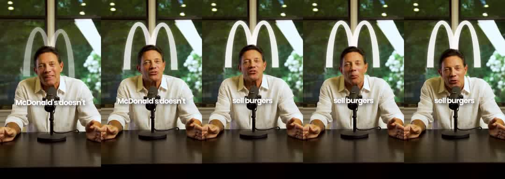

# v07_s05 · icon_overlay · 8.8–10.3s (calidad 5)

- **Guion:** McDonald's doesn't sell burgers.
- **Qué se ve:** Arcos de McDonald's blancos aparecen detrás de su cabeza. 'McDonald's doesn't' / 'sell burgers'.
- **Diseño:** Fondo de estudio: mesa negra brillante, micrófono de podcast negro en primer plano centrado, ventanal con columnas y vegetación verde desenfocada detrás (no croma). Subtítulos centrados sobre el pecho/micrófono.
- **Efectos:** Grade cálido-verdoso natural, piel cálida, negros profundos en la mesa; bajo el A-roll queda a veces una franja negra inferior (≈5–9 % del alto) cuando el plano está más abierto (observed 3.7, 37.5); sin grano ni viñeta añadida.
- **Animación:** Corte 8.72; logo fade+scale-up 8.79→9.06 (≈8 fr); sale fade 10.59→10.79.
- **Por qué aquí:** Repetición del patrón con otra marca: el logo literal.
