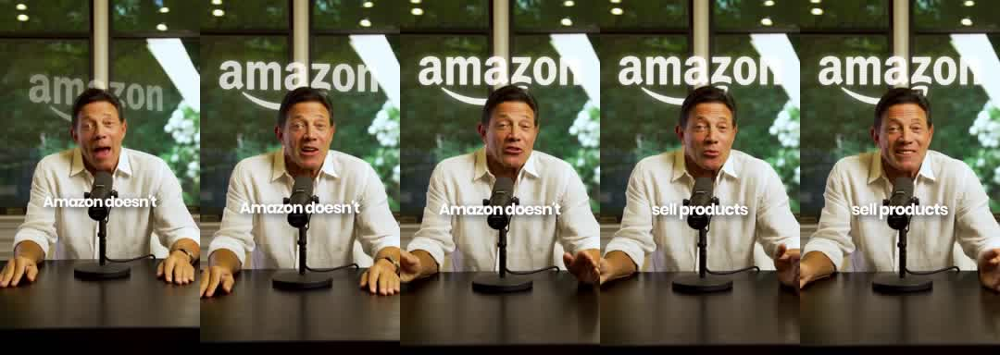

# v07_s07 · icon_overlay · 12.7–14.1s (calidad 5)

- **Guion:** Amazon doesn't sell products.
- **Qué se ve:** Logo 'amazon' blanco con sonrisa detrás de la cabeza. 'Amazon doesn't' / 'sell products'.
- **Diseño:** Fondo de estudio: mesa negra brillante, micrófono de podcast negro en primer plano centrado, ventanal con columnas y vegetación verde desenfocada detrás (no croma). Subtítulos centrados sobre el pecho/micrófono.
- **Efectos:** Grade cálido-verdoso natural, piel cálida, negros profundos en la mesa; bajo el A-roll queda a veces una franja negra inferior (≈5–9 % del alto) cuando el plano está más abierto (observed 3.7, 37.5); sin grano ni viñeta añadida.
- **Animación:** Corte 12.68; logo fade+blur-in 12.75→13.0.
- **Por qué aquí:** Tercera marca del patrón.
