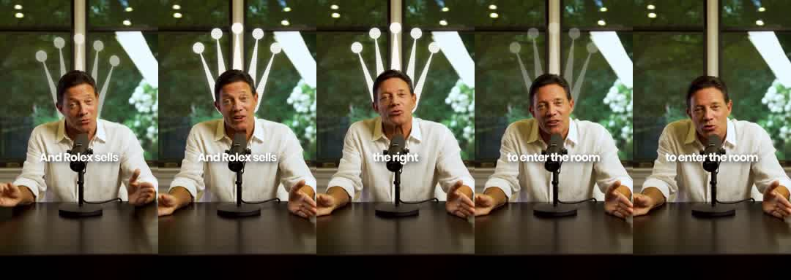

# v07_s09 · icon_overlay · 16.0–18.5s (calidad 5)

- **Guion:** And Rolex sells the right to enter the room
- **Qué se ve:** Corona de Rolex blanca (5 puntas con bolas) creciendo detrás de su cabeza: 'And Rolex sells' / 'the right'.
- **Diseño:** Fondo de estudio: mesa negra brillante, micrófono de podcast negro en primer plano centrado, ventanal con columnas y vegetación verde desenfocada detrás (no croma). Subtítulos centrados sobre el pecho/micrófono.
- **Efectos:** Grade cálido-verdoso natural, piel cálida, negros profundos en la mesa; bajo el A-roll queda a veces una franja negra inferior (≈5–9 % del alto) cuando el plano está más abierto (observed 3.7, 37.5); sin grano ni viñeta añadida.
- **Animación:** Corte 15.93; corona crece desde la cabeza hacia arriba con fade 16.0→16.27 (≈8 fr).
- **Por qué aquí:** Marca de lujo: la corona 'corona' su cabeza = estatus.
