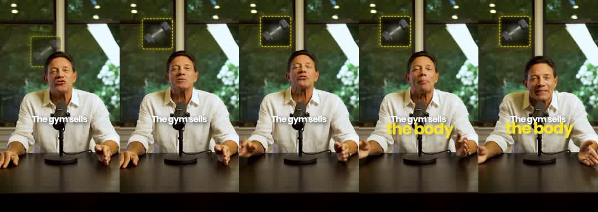

# v07_s13 · icon_overlay · 26.9–28.6s (calidad 4)

- **Guion:** The gym sells the body.
- **Qué se ve:** Arriba-izquierda aparece un recuadro con borde amarillo discontinuo (estilo 'selección' de software) con una mancuerna 3D gris. 'The gym sells' / 'the body' (amarillo).
- **Diseño:** Fondo de estudio: mesa negra brillante, micrófono de podcast negro en primer plano centrado, ventanal con columnas y vegetación verde desenfocada detrás (no croma). Subtítulos centrados sobre el pecho/micrófono. Recuadro transparente con borde punteado amarillo y esquinas marcadas.
- **Efectos:** Grade cálido-verdoso natural, piel cálida, negros profundos en la mesa; bajo el A-roll queda a veces una franja negra inferior (≈5–9 % del alto) cuando el plano está más abierto (observed 3.7, 37.5); sin grano ni viñeta añadida.
- **Animación:** Corte 26.90; recuadro entra deslizando en diagonal desde arriba-izquierda 26.97→27.2.
- **Por qué aquí:** Lista de 3 ejemplos: cada producto se 'colecciona' en la esquina como iconos.
