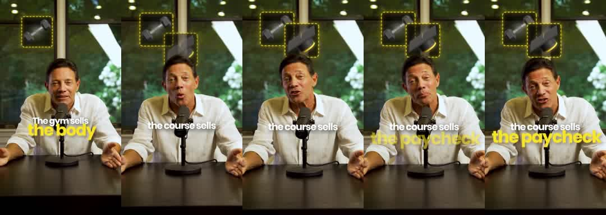

# v07_s14 · icon_overlay · 28.6–30.8s (calidad 4)

- **Guion:** The course sells the paycheck.
- **Qué se ve:** Segundo recuadro amarillo punteado solapado a la derecha (objeto 3D oscuro, posible portátil/libro). 'the course sells' / 'the paycheck' (amarillo).
- **Diseño:** Fondo de estudio: mesa negra brillante, micrófono de podcast negro en primer plano centrado, ventanal con columnas y vegetación verde desenfocada detrás (no croma). Subtítulos centrados sobre el pecho/micrófono.
- **Efectos:** Grade cálido-verdoso natural, piel cálida, negros profundos en la mesa; bajo el A-roll queda a veces una franja negra inferior (≈5–9 % del alto) cuando el plano está más abierto (observed 3.7, 37.5); sin grano ni viñeta añadida.
- **Animación:** Corte 28.86; recuadro 2 entra 28.96→29.2 desde arriba.
- **Por qué aquí:** Segundo ejemplo acumulado.
