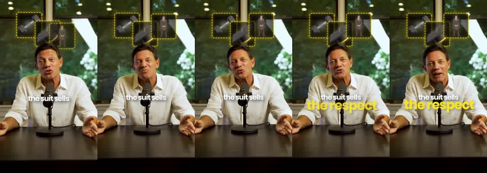

# v07_s15 · icon_overlay · 31.1–32.8s (calidad 4)

- **Guion:** The suit sells the respect.
- **Qué se ve:** Tercer recuadro con un traje (figura). 'the suit sells' / 'the respect' (amarillo).
- **Diseño:** Fondo de estudio: mesa negra brillante, micrófono de podcast negro en primer plano centrado, ventanal con columnas y vegetación verde desenfocada detrás (no croma). Subtítulos centrados sobre el pecho/micrófono.
- **Efectos:** Grade cálido-verdoso natural, piel cálida, negros profundos en la mesa; bajo el A-roll queda a veces una franja negra inferior (≈5–9 % del alto) cuando el plano está más abierto (observed 3.7, 37.5); sin grano ni viñeta añadida.
- **Animación:** Corte 30.99; recuadro 3 entra 31.06→31.3.
- **Por qué aquí:** Tercer ejemplo: cierra la regla de 3.
