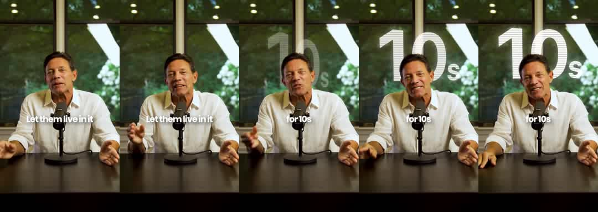

# v07_s19 · icon_overlay · 39.0–40.6s (calidad 4)

- **Guion:** Let them live in it for 10 seconds.
- **Qué se ve:** 'Let them live in it for 10 seconds.' — gran '10s' blanco semitransparente detrás de su cabeza.
- **Diseño:** Fondo de estudio: mesa negra brillante, micrófono de podcast negro en primer plano centrado, ventanal con columnas y vegetación verde desenfocada detrás (no croma). Subtítulos centrados sobre el pecho/micrófono. '10' sans bold enorme y 's' pequeña, blanco con transparencia ~60 %.
- **Efectos:** Grade cálido-verdoso natural, piel cálida, negros profundos en la mesa; bajo el A-roll queda a veces una franja negra inferior (≈5–9 % del alto) cuando el plano está más abierto (observed 3.7, 37.5); sin grano ni viñeta añadida. Leve glow.
- **Animación:** Corte 38.91; '10s' fade+scale-in 39.7→40.0 (a 'for' 39.74 / '10' 39.90); sale con fundido a negro 40.71.
- **Por qué aquí:** Dato numérico → número gigante detrás de él.
