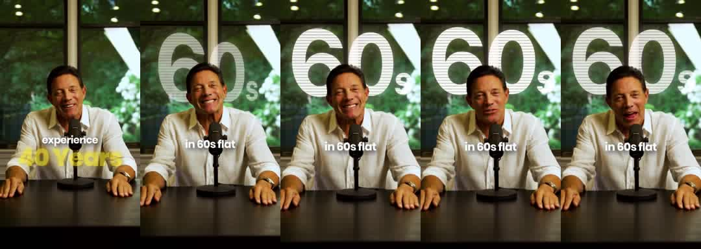

# v09_s02 · icon_overlay · 2.2–4.0s (calidad 5)

- **Guion:** in 60 seconds flat.
- **Qué se ve:** 'in 60s flat' — '60s' gigante blanco semitransparente detrás de la cabeza.
- **Diseño:** Estudio: mesa negra brillante, micrófono de podcast centrado, ventanal con vegetación detrás (no croma). Subtítulos centrados sobre el pecho. '60' sans bold enorme + 's' pequeña, blanco ~60 % de opacidad.
- **Efectos:** Grade cálido-verdoso natural; franja negra inferior en algunos encuadres; sin grano ni viñeta añadida.
- **Animación:** '60s' fade+escala 2.52→2.79 (a '60' 2.60); sale con blur/fade en el corte 4.13.
- **Por qué aquí:** Promesa numérica (60 s) visualizada como número gigante.
